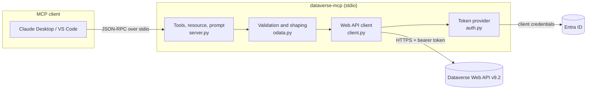

# dataverse-mcp-server

[](https://github.com/mateusmirandaia/dataverse-mcp-server/actions/workflows/ci.yml)
[](LICENSE)

An [MCP](https://modelcontextprotocol.io) server that gives AI agents (Claude Desktop, VS Code with
GitHub Copilot, or any MCP client) scoped access to Microsoft Dataverse and Dynamics 365 CE data
through the Web API.

It is read-only unless you say otherwise, it caps how many rows a single call can return, and it
only ever talks to the endpoints it was written for.

## Why

Most Dynamics 365 questions that end up as a ticket are lookups: "which open opportunities does
this account have", "what is the status reason on this case", "who owns these leads". An agent with
the right tools can answer them in seconds, but handing it a raw HTTP client and a service
principal is a bad idea. This server sits in between:

- the agent gets a handful of well-described tools instead of the whole Web API surface;
- requests are built from validated table names, column names and ids, so a tool call cannot be
  turned into a call to an arbitrary URL;
- results come back shaped for a model to read: choice labels and lookup names next to the raw
  values, no OData bookkeeping, and an explicit flag when a result was truncated;
- Dataverse errors are translated into messages the agent can act on (missing privilege, unknown
  column, throttling) instead of a stack trace.

## Architecture



The server runs as a child process of the MCP client and speaks JSON-RPC over stdin/stdout.
Authentication uses the client-credentials flow, so the agent acts as a Dataverse
[application user](https://learn.microsoft.com/power-platform/admin/manage-application-users)
and gets exactly the privileges of the security role you assign to it.

## Tools

| Tool | Writes | Description |
| --- | --- | --- |
| `list_tables` | no | Tables available to the connection. Customizable, non-intersect tables by default; `search` filters by name, `include_system` shows everything. |
| `describe_table` | no | Entity set, primary id/name and every readable column with its type, whether it is required, and for lookups the `_x_value` name to use in queries. |
| `query_records` | no | OData query with `select`, `filter`, `orderby` and `top`. Row count is capped; `more_records` tells the agent when there was more. |
| `get_record` | no | One row by id. Accepts ids with or without braces. |
| `create_record` | yes | Create a row, returns its id. Lookups are set with `navprop@odata.bind`. |
| `update_record` | yes | Update columns on an existing row. Never creates a row by accident (see below). |

Also exposed:

- **Resource** `dataverse://connection`: environment URL, write mode, row limits and the identity
  (`WhoAmI`) the server is running as. Useful for an agent to check what it is connected to.
- **Prompt** `explore_table`: describes a table and pulls a small sample, a quick way to get
  oriented in an unfamiliar org.

## Setup

### 1. Register an app in Entra ID

1. In the Azure portal, go to **Microsoft Entra ID > App registrations > New registration**.
   Single tenant, no redirect URI.
2. Under **Certificates & secrets**, create a client secret and copy its value.
3. Note the **Application (client) ID** and **Directory (tenant) ID**.

No API permissions need to be granted on the app registration. Access to Dataverse is controlled
entirely by the application user in the next step.

### 2. Create the Dataverse application user

1. Open the [Power Platform admin center](https://admin.powerplatform.microsoft.com), select the
   environment, then **Settings > Users + permissions > Application users > New app user**.
2. Pick the app registration from step 1 and a business unit.
3. Assign a security role.

Give it the smallest role that does the job. A good starting point is a copy of a read-only role
with Organization-level **Read** on only the tables the agent should see. If you enable writes,
add **Create** and **Write** on those specific tables, and leave **Delete**, **Assign** and
**Share** off. Avoid System Administrator and System Customizer: the server's own guardrails are
a second line of defense, not a substitute for Dataverse security.

### 3. Install and configure

Requires Python 3.11 or later.

```bash
git clone https://github.com/mateusmirandaia/dataverse-mcp-server.git
cd dataverse-mcp-server
python -m venv .venv
source .venv/bin/activate      # Windows: .venv\Scripts\activate
pip install -e .
cp .env.example .env           # then fill in the values
```

| Variable | Default | Notes |
| --- | --- | --- |
| `DATAVERSE_URL` | | Environment root, e.g. `https://yourorg.crm.dynamics.com` |
| `DATAVERSE_TENANT_ID` | | Directory (tenant) ID |
| `DATAVERSE_CLIENT_ID` | | Application (client) ID |
| `DATAVERSE_CLIENT_SECRET` | | Client secret value |
| `DATAVERSE_ALLOW_WRITES` | `false` | Exposes `create_record` and `update_record` when `true` |
| `DATAVERSE_DEFAULT_TOP` | `25` | Rows returned when the agent does not ask for a number |
| `DATAVERSE_MAX_TOP` | `200` | Hard ceiling per call (Dataverse itself stops at 5000) |
| `DATAVERSE_TIMEOUT_SECONDS` | `30` | Per-request timeout |

Settings are read from the environment first, then from `.env` in the working directory. In MCP
client configs it is usually simpler to pass them as `env`, as shown below.

### 4. Connect a client

**Claude Desktop**: edit `claude_desktop_config.json` (Settings > Developer > Edit Config):

```json
{
  "mcpServers": {
    "dataverse": {
      "command": "/path/to/dataverse-mcp-server/.venv/bin/dataverse-mcp",
      "env": {
        "DATAVERSE_URL": "https://yourorg.crm.dynamics.com",
        "DATAVERSE_TENANT_ID": "00000000-0000-0000-0000-000000000000",
        "DATAVERSE_CLIENT_ID": "00000000-0000-0000-0000-000000000000",
        "DATAVERSE_CLIENT_SECRET": "your-client-secret"
      }
    }
  }
}
```

On Windows the command is `C:\\path\\to\\dataverse-mcp-server\\.venv\\Scripts\\dataverse-mcp.exe`.

**VS Code** (GitHub Copilot agent mode): add `.vscode/mcp.json` to your workspace. Using an input
keeps the secret out of the file:

```json
{
  "inputs": [
    {
      "type": "promptString",
      "id": "dataverse-secret",
      "description": "Dataverse client secret",
      "password": true
    }
  ],
  "servers": {
    "dataverse": {
      "type": "stdio",
      "command": "${workspaceFolder}/.venv/bin/dataverse-mcp",
      "env": {
        "DATAVERSE_URL": "https://yourorg.crm.dynamics.com",
        "DATAVERSE_TENANT_ID": "00000000-0000-0000-0000-000000000000",
        "DATAVERSE_CLIENT_ID": "00000000-0000-0000-0000-000000000000",
        "DATAVERSE_CLIENT_SECRET": "${input:dataverse-secret}"
      }
    }
  }
}
```

Then ask something like *"List the five most recently created active accounts with their primary
contact"* and watch it go through `list_tables`, `describe_table` and `query_records`.

## Safety design

**Read-only by default.** An agent that can only read can at worst show you something it should
not have (which the security role already decides). An agent that can write can corrupt data at
machine speed, trigger plugins and Power Automate flows, and send emails through workflows. Write
tools are not registered at all unless `DATAVERSE_ALLOW_WRITES=true`, so the model never sees them,
and the client refuses writes independently of the tool layer. When you do enable writes, the
tools carry MCP annotations (`destructiveHint` on update) so clients can ask for confirmation.

**Row limits.** Every query is capped at `DATAVERSE_MAX_TOP` regardless of what the agent asks for.
The cap is applied through `Prefer: odata.maxpagesize` rather than `$top`, because Dataverse omits
`@odata.nextLink` when `$top` is present, and without it there is no way to tell the agent its
result was incomplete. The server never follows `nextLink` on its own; it reports
`more_records: true` and the agent is told to narrow the filter. This keeps context windows and
your API request allocation under control.

**No arbitrary URLs.** Tools take table logical names, column names and GUIDs, all validated
against a strict pattern before anything is sent. The entity set name is resolved from metadata,
not trusted from input. Filters travel as an encoded query-string value, so they cannot add query
options or change the path. Lookup binds on writes must look like `/entityset(guid)`.

**No accidental upserts.** A `PATCH` to Dataverse creates the record if the id does not exist. A
hallucinated id would silently produce a new row, so `update_record` always sends `If-Match: *`
and gets a 404 instead.

**Secrets.** The client secret is held as a `SecretStr` and never logged. Tokens are cached in
memory by MSAL and refreshed shortly before expiry; nothing is written to disk.

## Development

```bash
pip install -e ".[dev]"
ruff check . && ruff format --check .
pytest
```

Tests mock the Web API with [respx](https://lundberg.github.io/respx/) and drive the server through
the MCP SDK's in-memory client, so they run offline and need no Dataverse environment. They cover
query building and validation, `top` clamping, the write guard, error mapping (including
throttling and timeouts), token acquisition and the tool contract as a client sees it.

Layout:

```
src/dataverse_mcp/
  server.py   tool, resource and prompt definitions; CLI entry point
  client.py   async Web API client, metadata cache, error mapping
  odata.py    validation and query helpers, record shaping
  auth.py     MSAL client-credentials token provider
  config.py   settings (pydantic-settings)
  errors.py   exception types shown to the agent
```

## Roadmap

- FetchXML tool for aggregates and joins that OData handles poorly
- Choice (option set) values in `describe_table`, so agents can filter by value without guessing
- Certificate credentials and managed identity as alternatives to a client secret
- Table allow-list (`DATAVERSE_TABLES=account,contact,...`) on top of the security role
- Bounded retry on 429 using `Retry-After`
- Streamable HTTP transport for running as a shared service
- Optional audit log of write operations

## License

[MIT](LICENSE)
